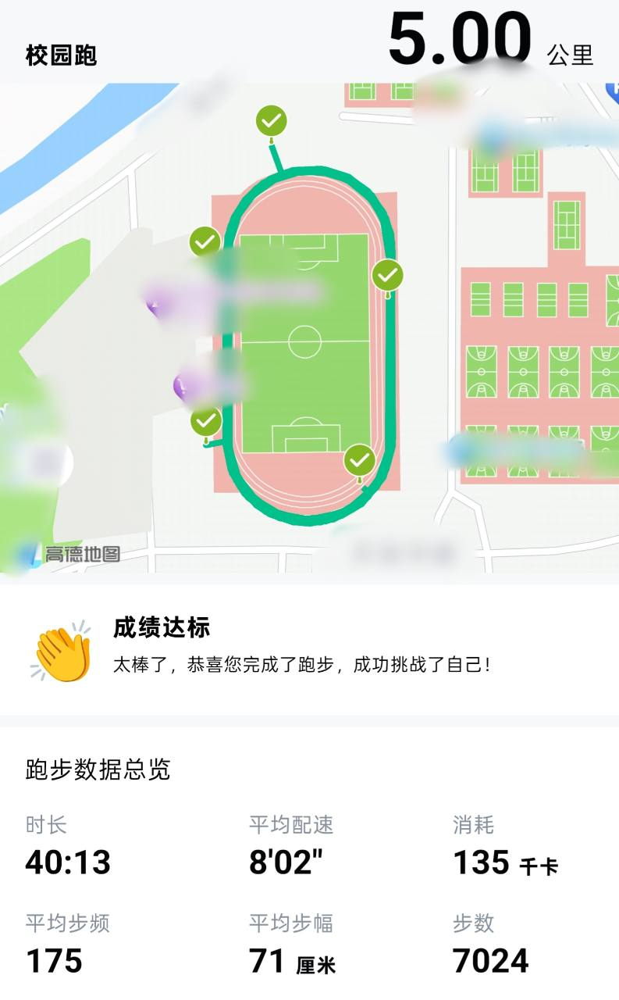
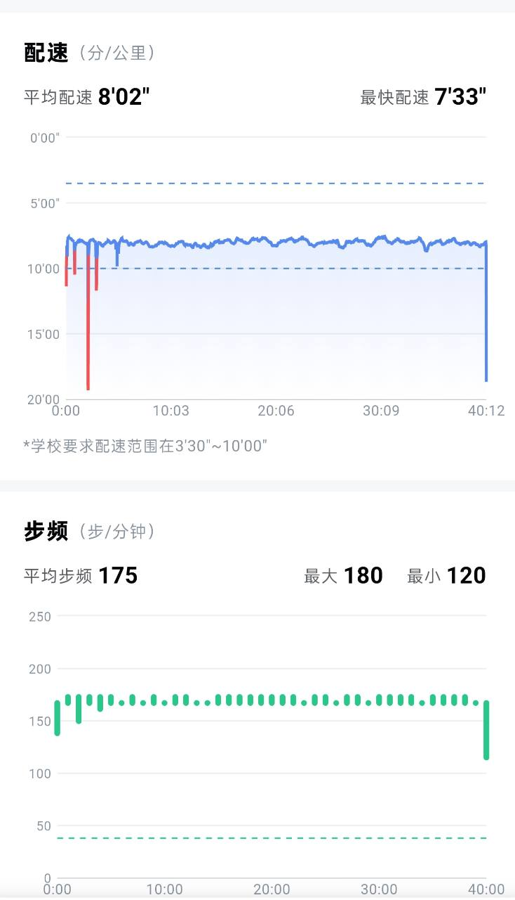

# 本 fork 的改动与使用说明

本分支在上游 7.3.92 Python 套件上整理了登录与登出、会话复用、轨迹关联和运动模型优化。下文说明本 fork 的新增行为；上游原始说明、声明与致谢完整保留在本文后半部分。

## 改了什么

| 改动 | 原先的问题 | 当前行为 |
| --- | --- | --- |
| 固定设备标识 | 多次启动可能使用不同设备上下文 | 安装首次生成标识并保存，后续启动复用；登出不删除标识 |
| 本地会话保存 | 每次调用都要重新传认证信息 | 成功登录后原子保存会话，未显式传认证信息时自动复用；失败登录不覆盖原缓存 |
| 登出与清理 | 缺少独立、可核实的退出入口 | 新增 `--logout` 与 `logout()`；确认旧会话失效后再清理对应缓存和内存认证信息 |
| 运行后退出 | 正常或异常结束后可能留下会话 | 可显式加 `--logout-after-run`；通过 `finally` 尝试退出，未确认时保留会话 |
| 登录输出 | 主 CLI 登录成功会打印原始 Token | 主 CLI 只报告登录成功；推荐使用密码隐藏的交互入口 |
| 地图轨迹关联 | 成绩与轨迹对象可能没有正确关联 | 先取得记录 ID，再绑定两个轨迹路径，上传后分别回读比较 |
| 成绩状态解析 | 仅依赖一个状态码可能误判 | 综合明确完成、拒绝标记和逐项规则结果；未知状态保留为待核验 |
| 配速与累计数据 | 地图配速单位及各统计来源不一致 | 配速单位在序列化边界转换，位置、距离、步数和 10 秒统计来自同一时间线 |
| 显式跑道 | 五点直连可能穿过跑道内场 | 可指定 BD-09 闭合路线，按顺序访问官方点位并验证路线几何 |
| 连续慢跑与多圈微变 | 恒速、每圈完全重合 | 默认连续慢跑；可复现随机种子；多圈微变最多向外 2 米 |
| V3.2 实验模型 | 按秒前瞻可能漏过秒内急弯 | 按最终路线求解运动约束，检查整秒内的弯点及制动距离，保留独立超限拒绝检查 |
| 离线预览与测试 | 难以在不登录时检查生成结果 | 可生成 HTML/JSON 对比；测试使用虚构数据和模拟服务响应 |

## 效果展示：Motion V3 + 多圈微变

以下为用户授权公开的手机 App 效果截图，地点文字已遮挡，展示该次路线、数据总览及配速／步频曲线。

| 路线与数据总览 | 配速与步频 |
| --- | --- |
|  |  |

## 环境与安装（Windows PowerShell）

- Python 3.13 为验证环境；Python 核心仅依赖标准库。
- 离线预览和单元测试不需要 Node.js、登录或真实账号数据。
- 登录需要 Node.js 18+、Playwright，以及可用的 Chrome、Edge 或 Playwright Chromium。

当前改动位于 PR 分支；合并后可以直接使用 `main`。

```powershell
git clone --branch feature/local-improvements-20261029 https://github.com/zixinchen007/-.git campus-run-protocol
Set-Location -LiteralPath '.\campus-run-protocol\协议\7.3.92'
py -3.13 -m venv .venv
.\.venv\Scripts\python.exe -X utf8 .\cli.py --help
```

如需登录，再安装浏览器依赖：

```powershell
npm install --prefix .\login playwright
```

`start.cmd` 和 `login_local.py` 会尝试选择已安装的系统 Chrome/Edge。若没有系统浏览器，可安装 Playwright Chromium：

```powershell
.\login\node_modules\.bin\playwright.cmd install chromium
```

使用其他位置的浏览器时，可在当前终端设置 `CHROMIUM_PATH` 指向自己的浏览器可执行文件。不要提交包含个人路径的配置。

## 先做离线预览

以下命令不创建登录客户端，不读取账号会话，也不提交记录。未传路线文件时使用虚构示意跑道。

```powershell
# 默认连续慢跑，与匀速基线比较
.\preview.cmd --distance 2537 --time-sec 1183 --seed 42

# V3 实验模型
.\preview.cmd --motion-model v3 --distance 5000 --time-sec 2401 --seed 42

# V3 加多圈走线微变
.\preview.cmd --motion-model v3 --lap-variation --distance 5000 --time-sec 2401 --seed 42
```

距离单位是**米**，时长单位是**秒**。`--seed` 用于复现同版本、同输入下的变化；省略时生成并记录种子。

命令输出 HTML 和 JSON 的绝对路径，默认保存在 `.local/previews/`。打开 HTML 可查看轨迹、分圈、速度、步频、累计数据与统计窗口。可以通过 `--output-dir` 更换输出目录。

可选参数：

- `--route-file`：自己提供的 BD-09 跑道 JSON，结构为 `{"coord_type":"bd09","loop":[[纬度,经度],...]}`；不要混用 GCJ-02。
- `--checkpoints-file`：本地参考点位数组，只有离线预览使用，不会请求官方点位。
- `--fences-file`：注明来源和日期的 BD-09 围栏快照，需同时使用 `--lap-variation`。

没有围栏快照时，预览会显示边界未验证。快照检查通过也不代表当前学校规则或当前时段允许提交。本仓库不附带任何个人路线、学校配置或真实围栏数据。

## 登录、复用会话与查询

推荐使用交互入口，避免将密码写进命令历史：

```powershell
.\.venv\Scripts\python.exe -X utf8 .\login_local.py
```

按提示输入账号和隐藏密码。登录成功后查询档案、规则和历史；后续可复用会话：

```powershell
.\start.cmd --rules --history
.\start.cmd --checkpoints
```

查询档案会在本机显示个人信息；请勿上传这类输出或截图。`--checkpoints` 只查询官方点位，不提交成绩。

会话保存在 `.local/session.json`，包含 Token 和账号上下文，**属于敏感明文文件**；密码不写入该文件。设备标识保存在 `.local/device_id.txt`。这些文件必须留在本机，不能通过 Git、日志或工单公开。

会话复用仅发生在没有显式传入认证上下文时；它不会绕过服务端会话失效或设备保护。缓存损坏时程序会报错，不自动覆盖。不要通过删除设备标识解决登录问题。

## 登出与运行后清理

独立退出当前已保存的会话：

```powershell
.\start.cmd --logout
```

- 不触发新的登录、运动提交或时间同步；没有会话时直接完成。
- 请求服务端登出后，继续用旧会话查询；只有明确返回未授权，才确认会话失效。
- 确认失效后清理与本次会话匹配的缓存及客户端认证信息，保留设备标识；其他会话的缓存不会被删除。
- 超时、网络错误、未知响应或本地清理失败均显示“退出未确认”，返回非零退出码并保留状态。之后重试 `--logout`，不要为退出问题重新提交记录。

`--logout` 不能与登录、查询或运行动作组合。默认运行后保留会话以便复用；只有显式使用 `--logout-after-run` 才会在运行结束或异常时尝试退出。

## 模型与在线调用

| 选项 | 定位 | 默认行为 |
| --- | --- | --- |
| `--motion-model jog` | 连续慢跑模型 | 主 CLI 默认；支持种子复现 |
| `--motion-model legacy` | 原匀速模型 | 显式选择；不使用 `--seed` |
| `--motion-model v3` | V3.2 运动约束实验模型 | 显式选择；包含起停和弯道约束 |

下面命令会调用真实提交接口，不属于离线预览。仅在自己的授权测试环境中运行，并自行核对服务端规则、有效时段和运行参数：

```powershell
.\start.cmd --run --motion-model v3 --distance 2537 --time-sec 1183 --seed 42 --logout-after-run
```

主 CLI 的运动类型为 `--mode 1`（默认计分跑）或 `--mode 6`（自由跑）。在线显式跑道使用 `--route-file`。普通 CLI 没有本机技能的完整请求 ID／恢复流程；结算结果不确定时不要盲目重复运行。

**多圈微变的接口区别：** `--lap-variation` 是离线预览参数，主 CLI 没有这个选项。在线 Python 调用使用已有的 `route_variation` 参数，并提供显式路线：

```python
import json
from pathlib import Path
from sport_client import SportClient792
from running.motion_v3 import MotionV3Options
from running.route_variation import RouteVariationOptions

# route.json 由使用者自行准备，不随仓库提供真实路线。
route = json.loads(Path("route.json").read_text(encoding="utf-8"))
client = SportClient792()  # 复用本机已登录会话
try:
    result = client.execute_run(
        target_distance_m=2537,
        target_time_sec=1183,
        route_loop=route["loop"],
        motion_options=MotionV3Options(seed=42),
        route_variation=RouteVariationOptions(),
    )
finally:
    if not client.logout():
        print("退出未确认，请单独重试退出；不要重复提交记录。")
```

`logout()` 返回是否完成退出确认与本地清理；没有活动会话时返回 `True`。登录和查询过程不自动登出；需要时显式调用。

## 验证结果与边界

```powershell
.\.venv\Scripts\python.exe -B -X utf8 -m unittest discover -q
```

现有模型与协议回归测试为 106 项，发布版另加登录／登出测试；以执行命令输出的总数为准。测试覆盖会话保存与复用、失败不覆盖、登出失效确认、失败保留、CLI 清理、轨迹包装与回读、配速单位、窗口总量、路线和 V3 弯道约束。

三种结果应分别理解：

1. **离线检查通过**：只证明该输入下生成数据的内部一致性。
2. **服务端即时回查通过**：记录当时的详情与轨迹回读满足检查，不能保证后续审核结果。
3. **手机 App 最终显示**：需要单独核验，不能由前两项推断。

V3 参数未经真人记录校准；模型不保证连续加速度、全程 jerk 或所有路线均可求解。超限、不可行或无法收敛时停止生成，不自动放宽阈值或切换模型。

## 发布隐私与许可

除上方用户明确授权公开、已遮挡地点文字的两张效果截图外，本分支只发布源码、测试和通用文档，不包含个人身份、凭据、设备文件、会话、原始轨迹文件、运行回执或本机一键技能。项目会话文件与 Windows DPAPI 技能存储不是同一机制；不要把本项目描述成已实现 DPAPI 加密。

大部分原有代码沿用上游 MIT 许可。V3 衍生模块单独适用 CC BY-NC 4.0，来源和修改说明见 [THIRD_PARTY_MOTION_V3.md](THIRD_PARTY_MOTION_V3.md) 与 [MOTION_V3_LICENSE.txt](MOTION_V3_LICENSE.txt)，不能将该模块概括为 MIT 许可。

专题文档：[登录与会话](本地使用说明.md)、[轨迹修复](协议/7.3.92/TRACK_FIX.md)、[连续慢跑](协议/7.3.92/MOTION_SIMULATION.md)、[多圈微变](协议/7.3.92/LAP_VARIATION.md)、[V3](协议/7.3.92/MOTION_V3.md)。

---

# 上游原始说明、声明与致谢

# 免责声明与致谢 (Disclaimer & Acknowledgments)

> **重要提示**：在使用、复制、修改或分发本仓库（`com.zjwh.android_wh_physicalfitness`）中的任何代码、模块或文档前，请务必仔细阅读以下全部内容。一旦您下载、安装、使用或分发本项目，即视为您已充分理解并完全同意本声明中的所有条款。

---

## 核心声明

```text
1. 仅面向 Android 逆向与纯 Python 网络协议工程化研究（按客户端版本独立归档维护）
2. 严禁任何形式的商业接单、有偿代跑与倒卖引流
3. 官方联系后将第一时间无条件停止维护并归档或下架仓库
```

---

## 一、项目维护与研究范围说明

### 1. 维护方向说明

本仓库按客户端版本独立维护脱离 Android 客户端与 Native SO 依赖的纯 Python 协议研究代码（当前包含 `协议/7.3.92` 模块化协议套件与 `协议/7.3.40` 独立解耦脚本），各版本之间互不干扰，仅用于协议演进对比与工程架构研究。

### 2. 技术研究目的

本项目仅面向以下技术领域的学习与交流：

```text
Android Reverse Engineering (Android 逆向工程研究)
Network Protocol Analysis (客户端网络通信协议分析)
Cryptographic Algorithm Reconstruction (NetSecKit 等密码学算法还原)
Automated Captcha Research (GeeTest v4 等验证码机制研究)
Mobile Application Security Research (移动应用安全研究)
```

### 3. 授权环境限制

本项目仅限在本人合法所有的设备、本人账号、本地模拟器或已获得明确授权的测试环境中用于技术探讨。

---

## 二、严禁商业接单与非法牟利

本项目为**完全免费、开源**的技术研究项目，受以下附加条款严格限制：

- **严禁商业代跑与接单**：严禁任何个人、团队、工作室或组织利用本项目（包括源码、脚本工具、衍生修改版）进行**商业接单、收费代跑、按次或包月收费**等行为。

- **严禁倒卖与付费引流**：严禁将本项目的代码或构建产物用于**闲鱼、淘宝、拼多多、社交平台倒卖、打包售卖、建立收费群准入、付费教程捆绑**等任何直接或间接的商业牟利行为。

- **违规追责声明**：对于任何违反上述规定、利用本项目进行商业牟利的行为，均属违规使用者个人行为，与本项目作者无关。欢迎社区成员对违规商用行为进行监督与举报，一切由此引发的法律纠纷与责任均由违规者自行承担。

---

## 三、官方联系与停更下架机制

本项目旨在进行客户端逆向与网络协议的工程化探索，**无意破坏目标软件（运动世界校园）的正常业务运营秩序**。

- 本项目完全尊重目标软件开发团队及相关权利人的知识产权与合法权益。

- **若软件官方（运动世界校园团队或相关权利人）认为本项目的存在对软件正常运营产生了不当影响并与本人取得联系，本人将在收到通知的第一时间无条件配合，立即停止本项目的全部维护、适配与版本更新，并对本 GitHub 仓库及相关发布渠道执行归档（Archive）或彻底移除下架处理。**

---

## 四、免责条款 (Legal Disclaimer)

- **合规使用**：使用者必须严格遵守所在国家或地区的法律法规、所在高校的规章制度以及目标软件的用户服务协议。

- **禁止滥用**：严禁将本项目用于破坏计算机信息系统、干扰目标服务器正常运转、未经授权获取他人数据或其他任何侵犯第三方合法权益的行为。

- **风险自担**：本项目按「原样（AS-IS）」提供，不附带任何明示或暗示的担保。使用者应自行承担因下载、安装、使用、修改或分发本项目所产生的一切直接或间接后果（包括但不限于：客户端闪退、数据异常、账号封禁、校规处分或相关法律责任）。本项目作者及贡献者不对任何因使用本项目而导致的损失或风险承担任何连带责任。

---

## 五、赞赏与感谢 (Sponsors)

开源项目的持续研究与维护离不开社区朋友的鼓励，特别感谢以下朋友对本项目的赞赏与支持：

| 赞赏者 | 致谢说明 |
| :---: | :---: |
| **VXiok** | 感谢对本项目的赞赏与支持 |

---

## 六、开源致谢 (Credits)

### JustTrustMePro

```text
Repository: hang666 / JustTrustMePro
```

感谢原作者开源的优秀工具。本项目在早期的 Android 动态调试与 HTTPS 证书校验（SSL Certificate Pinning）分析过程中曾参考或使用相关工具辅助研究。其相关版权及源代码归原作者所有。

---

## 七、联系方式与反馈渠道

- **Telegram 通知频道**：[https://t.me/Inverx200](https://t.me/Inverx200)

- **GitHub Issues**：[https://github.com/Inverx/com.zjwh.android_wh_physicalfitness/issues](https://github.com/Inverx/com.zjwh.android_wh_physicalfitness/issues)

---

# 运动世界校园协议工程

<p align="center">
  <b>Zjwh Physical Fitness · Android Protocol Analysis & Reverse Engineering</b>
</p>

<p align="center">
  面向「运动世界校园」Android 客户端的协议分析、逆向研究与纯 Python 工程化实现。
</p>

---

## Telegram

> 项目更新、版本适配及相关通知优先通过 Telegram 发布。

### 通知频道

**Telegram Channel：**  
https://t.me/Inverx200

用于发布：

- 项目更新
- 新版本适配
- Release 发布
- 协议变化通知
- 核心组件更新
- 重要公告

也可以直接通过 GitHub Issues 提交可复现的问题。

---

## 项目简介

本项目面向 **运动世界校园 Android 客户端（`com.zjwh.android_wh_physicalfitness`）**，主要用于 Android 逆向、网络协议分析及相关工程化研究。

通过对客户端的：

```text
静态分析
    +
动态调试
    +
HTTPS 流量分析
    +
Native SO / 密码学逻辑还原
    +
客户端全链路业务时序还原
```

逐步还原客户端相关网络通信与签名加解密逻辑（包括网易易盾 NetSecKit 4.2.4、极验 GeeTest v4 滑块验证、请求签名及 OBS 轨迹对象存储交互），并将协议能力重新实现为脱离 Android App 与 Native SO 依赖、可独立运行、便于维护和分析的纯 Python 工具。

项目目前主要包含两个阶段的协议实现：

```text
SportShield Protocol Suite (v7.3.92 模块化协议套件)
    +
Standalone Protocol CLI (v7.3.40 独立解耦脚本)
```

其中协议实现按照 **App 客户端版本独立维护**，避免不同版本之间的协议差异互相污染。

---

## 项目结构

```text
com.zjwh.android_wh_physicalfitness/
│
├── 协议/
│   ├── 7.3.40/
│   │   └── 运动世界校园 7.3.40 独立解耦 CLI 脚本实现
│   │
│   └── 7.3.92/
│       ├── core/             # 通用网络与加密基类 (NetSecKit 4.2.4, tokenSign, BaseClient)
│       ├── login/            # 登录认证与极验 v4 滑块求解套件
│       ├── profile/          # 个人档案与服务端 GMT 时间对齐套件
│       ├── policy/           # 跑步规则与校区电子围栏/打卡点套件
│       ├── telemetry/        # 启动埋点与页面曝光特征模拟套件
│       ├── running/          # 运动轨迹合成、华为云 OBS 异步推送与结算上报套件
│       ├── history/          # 跑后单次记录回查与打卡日历套件
│       ├── ads/              # 广告 SDK (adgain / adxvip) 曝光链路模拟套件
│       ├── sport_client.py   # 统一主客户端门面 (SportClient792)
│       ├── cli.py            # 统一主入口命令行终端工具
│       ├── requirements.txt  # 环境依赖说明
│       └── README.md         # 7.3.92 协议套件文档
│
├── LICENSE
└── README.md
```

### 版本目录

每个版本目录对应一次相对独立的客户端协议分析与架构演进结果。

例如：

```text
7.3.40  →  协议/7.3.40/  (单文件解耦 CLI 脚本架构)
7.3.92  →  协议/7.3.92/  (高度模块化包结构 + 统一 CLI 门面)
7.3.xx  →  协议/7.3.xx/
```

当客户端更新并出现：

```text
API Endpoint
Request Parameters
Headers / headerSign
Signature Salt
NetSecKit Encryption
Device Telemetry / CAID
GeeTest v4 Captcha
OBS Object Storage Payload
Protocol Timing Logic
```

等变化时，将优先通过建立新的版本目录进行适配，而不是直接覆盖历史实现。

这样可以保留不同 App 版本之间的协议差异，也方便后续进行版本对比与研究。

---

## 功能

不同版本架构与实现存在差异，目前项目涉及的主要模块与能力包括：

### 1. `v7.3.92` 模块化协议套件 (`协议/7.3.92/`)

| 模块 / 文件 | 功能 |
|---|---|
| `cli.py` | 统一命令行入口，支持参数组合调用全链路功能 |
| `sport_client.py` | 统一业务客户端门面 `SportClient792` |
| `core/` | NetSecKit 4.2.4 纯 Python 标准库实现（AES-128-CBC + Feistel KDF + RSA PKCS#1 v1.5）、`tokenSign` 与 `BaseClient` |
| `login/` | 账号密码认证与极验 v4 (GeeTest v4) 滑块自动识别求解 |
| `profile/` | 学生详细身份档案拉取与服务端 GMT 绝对时间戳对齐校准 |
| `policy/` | 校区电子围栏多边形、必经打卡点、配速/步频阈值与有效时段查询 |
| `telemetry/` | 冷启动特征（`startup/pv`）与页面曝光（`datacollection/pv`）埋点上报 |
| `running/` | 传感器与 GPS 轨迹点位合成、华为云 OBS 异步推送、31 字段 MD5 签名结算与单次成绩回查 |
| `history/` | 历史跑步记录分页查询、单次记录状态核验与打卡日历 |
| `ads/` | 广告 SDK（`adgain` / `adxvip`）Banner、弹窗与激励视频曝光事件链路模拟 |

### 2. `v7.3.40` 独立解耦脚本 (`协议/7.3.40/`)

| 模块 / 文件 | 功能 |
|---|---|
| `login_cli.py` | 登录认证换取凭证（Token / UID / UNID）与滑块自动验证 |
| `score_cli.py` | 学期总里程、达标状态与各模式完成统计查询 |
| `policy_cli.py` | 单次起跑要求、配速上下限、有效打卡时段、人脸抽检区间及电子围栏查询 |
| `history_cli.py` | 历史室外跑步或室内锻炼记录分页查询 |
| `rank_cli.py` | 个人日/月榜、班级榜、院系榜、室内榜、历史排名及违规通报查询 |
| `run_cli.py` | 室外跑步 GPS 点位、分桶速度、11 字段 OBS 轨迹上传与 31 字段签名包结算 |
| `indoor_cli.py` | 室内锻炼 16 字段签名包构造与结算提交 |
| `netsec_crypto.py` | 网易易盾 NetSecKit 4.2.4 密码学加解密实现 |
| `geetest_solver.py` | 极验 v4 滑块验证码图像分析与自动化求解 |
| `coordinate_utils.py` | 坐标转换、围栏校验与轨迹计算工具 |
| `security_utils.py` | 请求签名与安全校验辅助函数 |

具体文件及功能请以对应版本目录中的代码为准。

---

## 设计思路

项目并不是简单重放某个 HTTP 请求，而是尽可能将客户端网络协议与安全组件拆分为可维护的工程结构。

```text
                       Unified CLI / Standalone CLI
                                    │
                                    ▼
                        SportClient (Facade Layer)
                                    │
        ┌───────────────┬───────────┴───┬───────────────┐
        │               │               │               │
        ▼               ▼               ▼               ▼
  Running / OBS    Login / GeeTest   Policy / Fence  Telemetry / Ads
        │               │               │               │
        └───────────────┴───────────┬───┴───────────────┘
                                    │
                                    ▼
                     Core (NetSecKit 4.2.4 / tokenSign)
                                    │
                                    ▼
                           BaseClient / Network
```

业务入口层只处理命令行参数与流程编排，底层公共能力统一负责：

```text
服务端 GMT 时钟对齐
NetSecKit 4.2.4 载荷加解密 (AES-128-CBC + Feistel KDF + RSA)
请求头签名 (headerSign / tokenSign) 与业务 MD5 签名
极验 v4 (GeeTest v4) 滑块图像识别与轨迹生成
冷启动与页面曝光遥测特征上报
校区电子围栏多边形与必经点位规划
GPS 轨迹合成与华为云 OBS 对象存储上传
```

在 `v7.3.92` 中进一步还原了真实客户端的 **5 阶段全链路业务时序**：

```text
1. 冷启动与 GMT 时间对齐 (Cold Start & Time Sync)
    ↓
2. 规则与电子围栏预拉取 (Pre-flight Rules & Geofence)
    ↓
3. 物理静默采样期模拟 (Physical Running Window)
    ↓
4. OBS 轨迹推送与 31 字段签名结算 (OBS Upload & Save Record)
    ↓
5. 跑后单次记录回查与看板刷新 (Post-run Verification & Refresh)
```

减少重复请求代码、重复签名逻辑以及不同业务模块之间的强耦合。

---

## 环境

推荐环境：

```text
Python 3.10+
Node.js 18+ (用于 v7.3.92 极验滑块运行时)
Playwright Chromium
Windows / Linux / macOS
```

### 1. `v7.3.92` 环境准备

Python 协议核心层仅使用标准库，无需安装第三方 pip 包；滑块验证需安装 Playwright Chromium 运行时：

```bash
playwright install chromium
```

### 2. `v7.3.40` 环境准备

安装第三方依赖与 Playwright Chromium 内核：

```bash
pip install -r "协议/7.3.40/requirements.txt"
playwright install chromium
```

部分逆向与抓包研究场景可能还需要：

```text
ADB
Android 真机 / 模拟器
Root
LSPosed / Xposed
HTTPS 抓包工具 (Charles / Fiddler / Reqable / mitmproxy)
```

具体环境要求请以对应版本代码为准。

---

# 快速开始

## 1. Clone

```bash
git clone [https://github.com/Inverx/com.zjwh.android_wh_physicalfitness.git](https://github.com/Inverx/com.zjwh.android_wh_physicalfitness.git)
```

进入项目：

```bash
cd com.zjwh.android_wh_physicalfitness
```

---

## 2. 使用 `v7.3.92` 协议套件（推荐）

进入 `7.3.92` 目录：

```bash
cd "协议/7.3.92"
```

### (1) 服务端时钟对齐

```bash
python cli.py --sync-time
```

### (2) 账号密码登录（含极验 v4 滑块自动求解）

```bash
python cli.py -u <手机号> -p <密码>
```

### (3) 查询学生个人档案、跑步规则与电子围栏

```bash
python cli.py -t <Token> --uid <UID> --profile --rules --mode 1
```

### (4) 查询最近历史记录与达标状态

```bash
python cli.py -t <Token> --uid <UID> --history
```

### (5) 触发全时序跑步合成、OBS 上传与结算回查

```bash
python cli.py -t <Token> --uid <UID> --unid <UNID> --run --mode 1 --distance 2150 --time-sec 760
```

其中 `--mode 1` 为计分跑（默认），`--mode 6` 为自由跑。

### (6) 模拟看广告与激励视频曝光链路

```bash
python cli.py -t <Token> --uid <UID> --watch-ad --ad-pos 4 --ad-duration 15
```

其中 `--ad-pos` 支持 `1`（Banner）、`2`（弹窗）、`4`（激励视频，默认）。

查看完整参数说明：

```bash
python cli.py --help
```

---

## 3. 使用 `v7.3.40` 独立模块脚本

进入 `7.3.40` 目录：

```bash
cd "协议/7.3.40"
```

- **登录认证换取凭证**：
  ```bash
  python login_cli.py
  ```
- **学期成绩与完成情况查询**：
  ```bash
  python score_cli.py
  ```
- **学校跑步规则与电子围栏查询**：
  ```bash
  python policy_cli.py
  ```
- **历史运动记录查询**：
  ```bash
  python history_cli.py --type outdoor
  ```
- **校园多维排行榜查询**：
  ```bash
  python rank_cli.py --type 1 --sort 1
  ```
- **室外跑步打卡提交**（`--type 1` 计分跑 / `--type 4` 自由跑）：
  ```bash
  python run_cli.py --type 4 -d 2000 --time 720
  ```
- **室内锻炼打卡提交**：
  ```bash
  python indoor_cli.py --time 1200 --steps 2000
  ```

---

# 密码学与安全组件还原

客户端核心通信受网易易盾 **NetSecKit 4.2.4** 与多层签名机制保护。

本项目在纯 Python 环境下完成了相关算法的分析与无 Native SO 还原：

```text
NetSecKit 4.2.4
    ├── AES-128-CBC 对称加解密
    ├── Feistel 变体密钥派生 (KDF)
    └── RSA PKCS#1 v1.5 密钥封装
```

同时涵盖业务层校验逻辑：

```text
headerSign / tokenSign 请求头签名
    +
运动结算 31 字段加盐 MD5 签名
    +
室内锻炼 16 字段加盐 MD5 签名
```

在 `v7.3.92` 中，上述加解密逻辑已全部基于 Python 标准库重构于 `core/` 模块内，彻底移除外部二进制与 Native SO 依赖。

---

# HTTPS 流量分析

部分 Android 网络请求存在：

```text
SSL Certificate Pinning
```

等证书校验机制。

在授权研究环境中，可以结合：

```text
Android Device / Emulator
        │
        ├── Root
        ├── LSPosed / Xposed
        └── SSL Pinning Research Module
                    │
                    ▼
                HTTPS Proxy
                    │
                    ▼
            Request / Response (HAR)
                    │
                    ▼
              Protocol Analysis
```

进行客户端网络通信与业务时序分析。

本项目研究过程中曾使用：

**hang666 / JustTrustMePro**

辅助分析 Android SSL Certificate Pinning。

相关项目版权及源代码归原作者所有，本仓库不包含其源代码或 APK。

---

# 协议分析流程

项目中协议实现来源于以下分析流程：

```text
Android APK & Native SO
    │
    ▼
Static Analysis (JADX / IDA / Ghidra)
    │
    ▼
Dynamic Analysis & Hook
    │
    ▼
Network Traffic (HAR Capture)
    │
    ▼
Request / Response Field Diff
    │
    ▼
NetSecKit Crypto & Signature Reconstruction
    │
    ▼
Full-Lifecycle Timing & Telemetry Analysis
    │
    ▼
Pure Python Implementation
```

最终将：

```text
NetSecKit Crypto
Request Signature
GeeTest v4 Captcha
Session & GMT Time Sync
Device Telemetry & Ads
GeoFence & Coordinate
OBS Track Upload
```

拆分并重新实现为相互独立的纯 Python 模块。

---

# 验证码

登录认证等流程包含 **极验 v4 (GeeTest v4)** 滑块人机验证机制。

项目中包含独立的滑块求解模块（`login/` 与 `geetest_solver.py`），涉及：

```text
Playwright Chromium Headless Rendering
OpenCV / Image Processing
缺口边缘检测与模板匹配
拟人化拖拽轨迹生成
```

验证码处理作为独立适配层存在，避免与核心业务代码强耦合。

---

# 坐标与电子围栏

涉及校园运动协议研究时，需要处理客户端中的校区电子围栏、必经打卡点及运动轨迹数据。

相关逻辑集中在 `running/`、`policy/` 与 `coordinate_utils.py`，包括：

```text
Coordinate Validation & GCJ-02 / WGS-84 Handling
Polygon GeoFence (校区电子围栏多边形校验)
Checkpoint Routing (必经打卡点路径规划)
GPS Point & Speed Bucket Synthesis (配速分桶与点位生成)
OBS Track Object Serialization (华为云 OBS 轨迹对象构造)
```

坐标与轨迹通过统一数据结构进行校验与生成，避免不同业务模块分别维护相同逻辑。

---

# 隐私与数据安全

请 **不要** 将真实用户敏感信息提交到公开仓库。

包括但不限于：

```text
手机号
密码
Token
UID / UNID
Cookie
Session
Device ID / CAID / OAID / Android ID
真实姓名与学号
学校与院系班级信息
真实 GPS 轨迹
个人运动数据
```

运行过程中生成的账号、Token、设备参数及调试信息应只保存在本地。

提交以下内容之前：

```text
Issue
Pull Request
Debug Log
Screenshot
HAR 抓包文件
```

请自行检查并删除其中可能存在的个人信息、认证凭据及设备标识。

---

# Issue / Pull Request

欢迎提交：

```text
Bug Report
Protocol Change
Version Compatibility
Code Improvement
Documentation
Reverse Engineering Research
```

如果客户端更新导致协议失效，建议 Issue 中至少提供：

```text
App Version (如 7.3.92 / 7.3.40)
Python Version
Node.js / Playwright Version
Error Message
Minimal Reproduction
```

请不要在 Issue 中公开：

```text
账号
密码
Token
UID / UNID
完整抓包敏感字段
个人身份信息
```

---

# Telegram

项目更新：

**https://t.me/Inverx200**

如果发现新版本协议变化、兼容性问题或项目 Bug，也可以通过 GitHub Issues 反馈。

---

# Research & Disclaimer

本项目主要用于：

```text
Android Reverse Engineering
Network Protocol Analysis
NetSecKit Cryptographic Research
Python Protocol Engineering
Application Security Research
Android HTTPS Traffic Analysis
```

以及本人设备、本人账号或获得明确授权环境中的安全研究与技术学习。

请遵守所在地法律法规、目标服务的相关规则及授权范围。

请勿将本项目用于未经授权的账号访问、数据获取、系统操作或其他侵犯第三方权益的行为。

使用者应自行承担因使用、修改或分发本项目所产生的责任。

---

# Credits

### JustTrustMePro

感谢：

```text
hang666 / JustTrustMePro
```

本项目在 Android HTTPS 协议分析过程中参考或使用相关工具辅助研究 SSL Certificate Pinning。

其版权及源代码归原作者所有。

---

# License

本项目基于 **MIT License** 开源。

详见：

```text
LICENSE
```

---

<p align="center">
  <b>Android Reverse Engineering · Protocol Analysis · Pure Python</b>
</p>

  ·
  <a href="https://github.com/Inverx/com.zjwh.android_wh_physicalfitness/issues">Issues</a>
</p>
